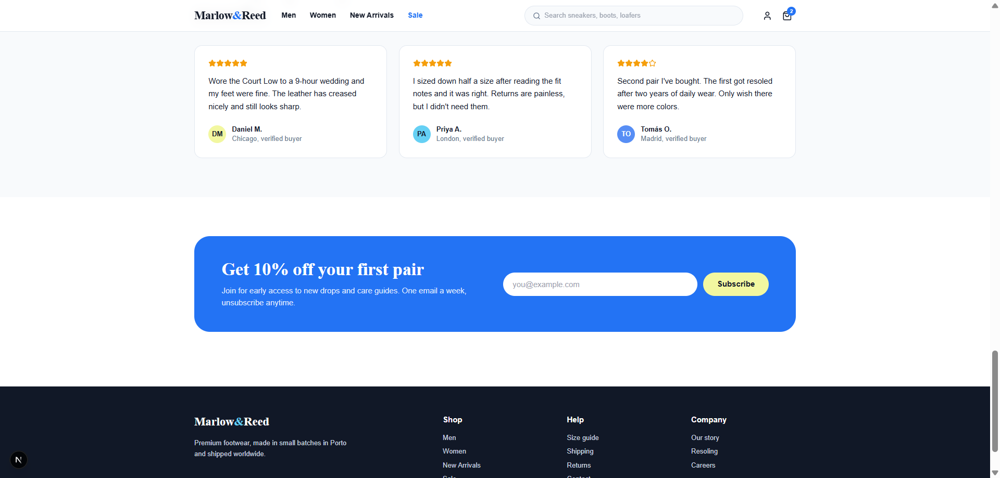

# 👞 Marlow & Reed — Handcrafted Luxury Footwear

<p align="center">
  
</p>

<p align="center">
  <strong>A modern, ultra-fast luxury footwear e-commerce frontend built with Next.js, TypeScript, Tailwind CSS, and Motion for React.</strong>
</p>

<p align="center">
  
  
  
  
  
  
</p>

---

## 📖 Overview

**Marlow & Reed** is an artisanal footwear brand engineered for quality, longevity, and modern aesthetics. Built in small batches in Porto using Italian vegetable-tanned full-grain leather, each pair is crafted to age gracefully with everyday wear.

This repository contains the complete frontend architecture built with pixel-perfect precision, micro-interactions, responsive typography, and state management ready to connect directly to a backend API (PostgreSQL + Prisma).

---

## 📸 Preview & Screenshots

<div align="center">
  <table>
    <tr>
      <td width="50%">
        <h4 align="center">🌟 Hero & Brand Identity</h4>
        
      </td>
      <td width="50%">
        <h4 align="center">👟 Season's Favorites Catalog</h4>
        
      </td>
    </tr>
    <tr>
      <td width="50%">
        <h4 align="center">🌿 Craftsmanship & Storytelling</h4>
        
      </td>
      <td width="50%">
        <h4 align="center">⭐ Value Props, Reviews & Newsletter</h4>
        
      </td>
    </tr>
  </table>
</div>

---

## ✨ Key Features

### 🛍️ E-Commerce Experience
- **Dynamic Header & Navigation**: Sticky header with backdrop blur, responsive mobile drawer, search bar, and real-time cart badge counter.
- **Interactive Product Catalog**:
  - Live color palette swatches for each pair.
  - Interactive wishlist heart toggle with pulse feedback.
  - Price tags with sale strike-through discounts.
  - Instant **"Add to Cart"** button feedback with animated badge updates.
- **Cart Drawer (`motion/react`)**:
  - Slide-over drawer with backdrop blur.
  - Dynamic free-shipping progress tracker (Threshold: **$120**).
  - Quantity controls (`+` / `-`), item removal, and subtotal calculation.
- **Artisan Narrative (`#story`)**: Highlighting full-grain vegetable leather, 40 Porto master craftsmen, and day-one ergonomic comfort.
- **Trust Elements**: 30-day wear-around returns, free worldwide shipping over $120, and numbered authenticity certificates.
- **Verified Customer Testimonials**: Real feedback with verified buyer badges.
- **Newsletter Subscription**: Interactive subscription form with regex email validation and instant status feedback.

---

## 🏗️ Project Architecture

```plaintext
E-commerce/
├── Scrinshouts/                # Screenshots for preview documentation
│   ├── hero page.png
│   ├── new arrivage page.png
│   ├── part3 description.png
│   └── part4+fouter.png
├── src/
│   ├── app/
│   │   ├── globals.css         # Complete compiled styles, Google Fonts & custom utilities
│   │   ├── layout.tsx          # Root layout with metadata & typography
│   │   └── page.tsx            # High-performance landing page component
│   ├── components/             # Reusable UI components
│   │   ├── AnnouncementBar.tsx # Top promotional banner
│   │   ├── Header.tsx          # Sticky navigation & search
│   │   ├── Hero.tsx            # Hero typography & featured product badge
│   │   ├── ProductCard.tsx     # Interactive product card
│   │   ├── ProductGrid.tsx     # Season's favorites showcase
│   │   ├── StorySection.tsx    # Brand story & craft details
│   │   ├── ValueProps.tsx      # Free shipping & return guarantees
│   │   ├── ReviewsSection.tsx  # Customer testimonials
│   │   ├── Newsletter.tsx      # Email capture with validation
│   │   ├── Footer.tsx          # Full footer navigation
│   │   └── CartDrawer.tsx      # Motion slide-over cart drawer
│   ├── context/
│   │   └── CartContext.tsx     # Global cart state (add, remove, quantity, total)
│   ├── data/
│   │   └── products.ts         # Product catalog and reviews dataset
│   └── types/
│       └── index.ts            # TypeScript interfaces (Product, CartItem, Review)
├── next.config.ts              # Next.js & Turbopack configuration
├── package.json                # Dependencies and project scripts
├── tsconfig.json               # TypeScript strict configuration
└── README.md                   # Project documentation
```

---

## 💻 Tech Stack

| Technology | Purpose |
| :--- | :--- |
| **[Next.js](https://nextjs.org/)** (v16 App Router) | React Framework for SSR, performance, and SEO |
| **[TypeScript](https://www.typescriptlang.org/)** | Type safety, maintainability, and clean data contracts |
| **[Tailwind CSS](https://tailwindcss.com/)** | Utility-first styling with responsive design |
| **[Motion for React](https://motion.dev/)** | Smooth micro-interactions and cart drawer animations |
| **[Lucide Icons](https://lucide.dev/)** | Clean, lightweight icon suite |
| **[Google Fonts](https://fonts.google.com/)** | Custom typography: *Playfair Display*, *Biryani*, *Arapey* |

---

## 🚀 Getting Started

### Prerequisites
- **Node.js**: v18.17.0 or higher
- **npm**: v9 or higher

### Installation

1. **Clone the repository**:
   ```bash
   git clone https://github.com/OussEmabouchahwa/e-comerce.git
   cd e-comerce
   ```

2. **Install dependencies**:
   ```bash
   npm install
   ```

3. **Start the development server**:
   ```bash
   npm run dev
   ```

4. **Open in browser**:
   Navigate to [http://localhost:3000](http://localhost:3000)

### Production Build

```bash
npm run build
npm run start
```

---

## 🛣️ Fullstack Roadmap (Next Steps)

- [ ] **PostgreSQL Database**: Persistent storage for products, orders, customers, and inventory.
- [ ] **Prisma ORM**: Type-safe database queries and migrations.
- [ ] **Authentication**: NextAuth.js or Clerk for customer profiles and order history.
- [ ] **Payment Integration**: Stripe / Paymee checkout webhook integration.
- [ ] **Cloudinary / CDN**: Dynamic image optimization, resizing, and AVIF delivery.

---

## 👤 Author

- **GitHub**: [@OussEmabouchahwa](https://github.com/OussEmabouchahwa)
- **Repository**: [e-comerce](https://github.com/OussEmabouchahwa/e-comerce)

---

## 📄 License

This project is licensed under the [MIT License](LICENSE).
